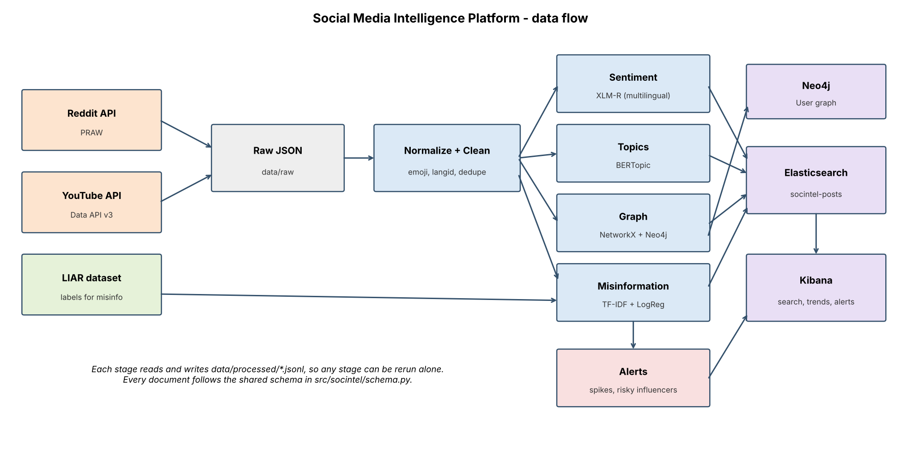

# Social Media Intelligence Platform

Collects YouTube comments (live) and benchmarks on public datasets, then works out what people are talking
about, how they feel about it, who drives the conversation, and which posts look like known misinformation.
Everything ends up in Elasticsearch and Kibana for search, trends and alerts.

Reddit collection is built in but **switched off**, because Reddit requires approval for data access (see
"Data sources and compliance" below).



## What it does

| Stage | What | Tools |
|---|---|---|
| 1. Collect | YouTube videos + comments + replies, raw JSON on disk (Reddit collector available but disabled) | YouTube Data API v3, PRAW |
| 2. Clean | strip URLs/mentions/markdown, emojis turned into words, language detection, dedupe | `emoji`, `py3langid` (Spark NLP version in `spark_stage.py`) |
| 3. Sentiment | multilingual negative/neutral/positive, tracked per week | `cardiffnlp/twitter-xlm-roberta-base-sentiment` |
| 4. Topics | topic discovery and topics over time | BERTopic + multilingual MiniLM embeddings |
| 5. Graph | who replies to whom, PageRank influencers, Louvain communities | NetworkX, Neo4j |
| 6. Misinformation | claim classifier trained on LIAR (TF-IDF + LogReg baseline, optional DistilBERT) | scikit-learn, transformers |
| 7. Index | bulk index into one schema, dashboards, alerts | Elasticsearch 8, Kibana 8 |

## Setup

Needs Python 3.10+ and Docker.

```bash
git clone <this repo> && cd social-intel
python -m venv .venv && source .venv/bin/activate
pip install -r requirements.txt

cp .env.example .env            # add YOUTUBE_API_KEY and an AUTHOR_SALT (any random string)
docker compose up -d            # Elasticsearch :9200, Kibana :5601
docker compose --profile graph up -d neo4j   # optional, Neo4j :7474 (heavy on small machines)
```

Credentials: a YouTube Data API v3 key from Google Cloud Console. Reddit credentials are only needed if Reddit
has approved your access.

Datasets:
- LIAR: let `datasets` fetch it, or put the original `train.tsv`, `valid.tsv`, `test.tsv` in `data/liar/`.
- SNAP Reddit Hyperlink Network: download `soc-redditHyperlinks-title.tsv` from
  https://snap.stanford.edu/data/soc-RedditHyperlinks.html into `data/snap/`.
- TweetEval and the Multilingual Amazon Reviews corpus are downloaded from Hugging Face automatically.

## Run it

```bash
export PYTHONPATH=src
python -m socintel.collect_youtube        # watch the daily quota, see docstring

python -m socintel.run_pipeline benchmarks # accuracy on TweetEval, Amazon (per language), SNAP graph
python -m socintel.run_pipeline all        # clean -> sentiment -> topics -> graph -> misinfo -> alerts -> index
# or one at a time:
python -m socintel.run_pipeline clean sentiment

python scripts/setup_kibana.py --import kibana/dashboards.ndjson   # data view + dashboards (docs/kibana.md)
```

Intermediate files go to `data/processed/`. All headline numbers are written to `data/processed/metrics.json`.

## Tests

```bash
python -m pytest -q
```

The tests run on small synthetic data and need no network, models or Docker: cleaning, normalisation, sentiment
aggregation, graph/PageRank/communities, misinformation classifier, alert rules and Elasticsearch document
preparation.

## Repo layout

```
src/socintel/   one module per stage + run_pipeline.py
tests/          pytest suite
docs/           architecture, data dictionary, Kibana guide, results, presentation outline
scripts/        kibana setup, diagram generator
config.yaml     subreddits, queries, model names, thresholds
```

## Data sources and compliance

- **YouTube** (live data): used through the official Data API under its terms; the collector stays inside the
  default daily quota. Check the YouTube API Services policies on how long you may keep API data.
- **Reddit:** Reddit's Responsible Builder Policy requires explicit approval for access to Reddit data (researchers
  apply through Reddit for Researchers) and prohibits using the data to train ML models or to infer sensitive
  traits about users. We have not collected live Reddit data. `collect_reddit.py` refuses to run unless
  `reddit.enabled: true`, which should only be set after approval. The only Reddit-derived data used is the
  SNAP Reddit Hyperlink Network, a published academic dataset of subreddit-to-subreddit links (no user accounts).
- **Public datasets:** TweetEval, Multilingual Amazon Reviews, LIAR, SNAP, each under its own licence.
- **Privacy:** author names are replaced with a salted hash before anything is stored or indexed
  (`anonymize_authors` in `config.yaml`). The pipeline only uses pretrained models for sentiment and topics; it
  does not fine-tune on collected posts. Do not put raw collected data in shared folders.
- The "flagged high-reach content" alert lists posts for review. It is not a judgement about any account.

## Design decisions and caveats

- **One schema.** Every stage works on the same columns (`docs/data_dictionary.md`), so indexing is trivial.
- **Emojis are converted to words, not dropped**, because they carry sentiment.
- **Language `und`** is used for very short texts, where language ID is unreliable.
- **Misinformation model is trained on LIAR** (political fact-check statements). Reddit and YouTube comments are a
  different kind of text, so `misinfo_prob` means "resembles claims that fact-checkers rated misleading", not
  "is false". Treat it as a ranking signal for review. LIAR labels are also collapsed to binary
  (pants-fire/false/barely-true = 1); that cut-off is a choice.
- **Reply graph only sees replies inside the collected data.** YouTube returns up to 5 replies per thread inline,
  so deep threads are truncated and the graph is sparser than the real conversation. The SNAP network is used to
  show the graph code at scale (it links subreddits, not people).
- **Sentiment over time** needs timestamps, so it runs on the YouTube data; TweetEval and Amazon reviews are used
  for accuracy only.
- **Spark NLP stage** (`spark_stage.py`) is written but was not executed in the development environment.
  Verify the pretrained model name before using it.
- Respect Reddit's Data API terms and YouTube's API Services terms; don't redistribute raw data.

## Results

Full numbers and discussion in `docs/results.md`; every figure comes from `data/processed/metrics.json`.

Headline (11,233 YouTube comments, 299 videos, 12 search queries in 6 languages):

| | |
|---|---|
| Sentiment, TweetEval (EN tweets) | accuracy 0.661, macro-F1 0.660 |
| Sentiment, Amazon reviews, 6 languages | accuracy 0.629 to 0.688, macro-F1 0.525 to 0.584 |
| Sentiment vs hand labels on our own comments | accuracy 0.73, macro-F1 0.695 (n = 100) |
| Topics (BERTopic) | 95 topics, 37.5% of comments left as outliers |
| Misinformation, LIAR test (TF-IDF + LogReg) | accuracy 0.632, F1 0.579, ROC-AUC 0.671 |
| Elasticsearch | 11,233 docs indexed, 0 errors, about 2,300 docs/s, sample query 72 ms |
| SNAP subreddit graph | 54,075 nodes, 234,792 edges, modularity 0.47 |

Caveats worth knowing before reading anything into the charts: 39% of the comments fall in the last week of
collection (YouTube search returns recent videos), so the time series is dominated by that week; the comment-reply
graph is very fragmented (434 components, the largest holding 52 users); and the misinformation score reflects
LIAR's political-statement style, not truth.

## Next steps

Fine-tune the misinformation model on in-domain labelled posts; add sentiment evaluation per language; stream
collection instead of batch; build the Kibana alert rule into Watcher/Slack notifications.

## Public demo

A small Streamlit app (`app/streamlit_app.py`) shows the measured results from `demo_data/` (aggregate numbers only:
no comment text, no user ids). Rebuild the data after a pipeline run with `python scripts/export_demo_data.py`, run it
locally with `pip install -r app/requirements.txt` and `streamlit run app/streamlit_app.py`, or deploy it on
Streamlit Community Cloud (main file `app/streamlit_app.py`).